# IC review: U8 TPS54336A, U5 CD4541B vs datasheet (2026-11-05; U8 updated 2026-11-06)

Datasheets: TI **SLVSCD5D** (`ref/datasheets/TI_TPS54336A_SLVSCD5D.pdf`) and TI **SCHS085E** (`ref/datasheets/TI_CD4541B.pdf`). Our values: `docs/SPEC.md` sections 3, 4, 5, 7; `tools/design_calc.py` (run 2026-11-05); the schematic and the routed board (exported 2026-11-05). Calc numbers come from `design_calc.py` unless marked "hand".

---

## U8 TPS54336A buck (5.07 V, 3 A)

**2026-11-06 update (A22):** the five flags below are fixed (DECISIONS 2026-11-06, `tools/post_sch/16`, `tools/post_route/16`); tables and crops show the new design.

### Circuit

| Datasheet: Fig. 38 typical application + Table 3 (p34) | Ours (schematic) |
|---|---|
| 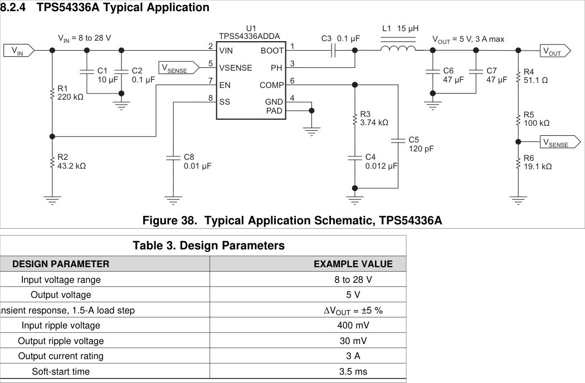 | 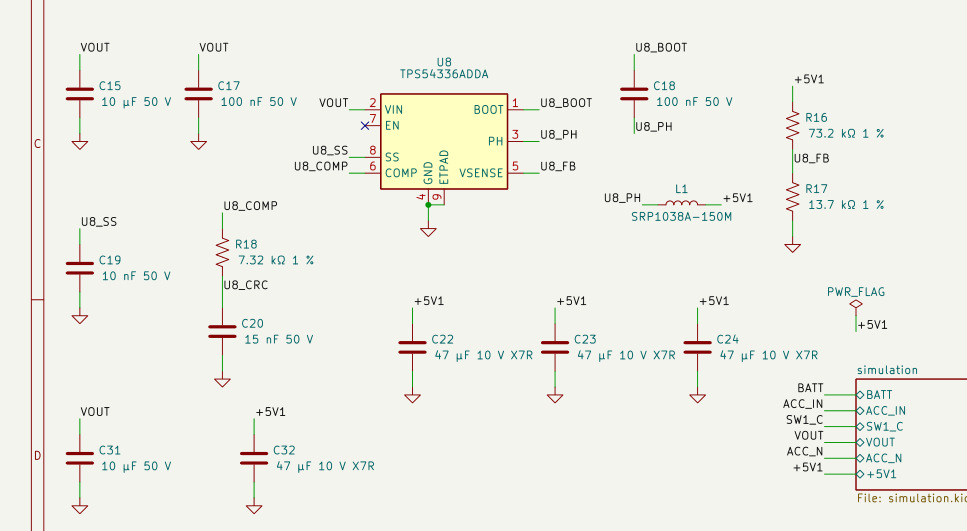 |

How our circuit differs from the TI example:
- EN is left floating. TI uses R1/R2 to set UVLO.
- No C5 high-frequency pole capacitor (Type 2B compensation).
- L 15 µH (as TI), 4 × 47 µF out (TI: 2 × 47 µF), 2 × 10 µF in (TI: 1).

### Tuning

| Datasheet equations |  |
|---|---|
| FB eq 15/16, L eq 19 + K_IND, Cin eq 17/18 | 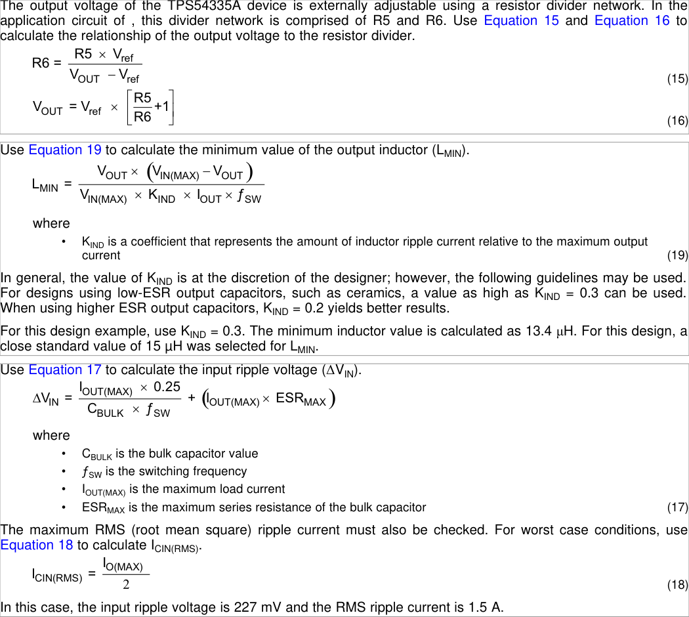 |
| Cout eq 22–24, compensation eq 10–14 | 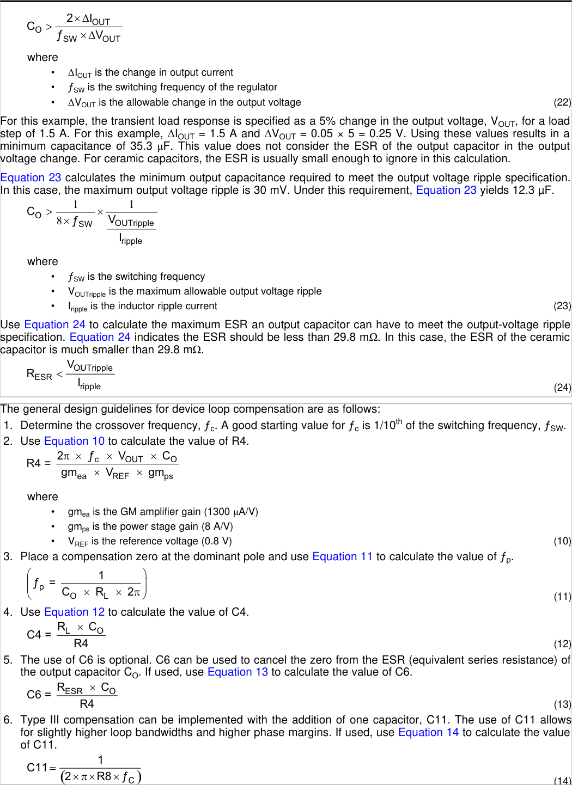 |
| SS eq 5, BOOT, EN pin, VIN UVLO, min on-time, fsw | 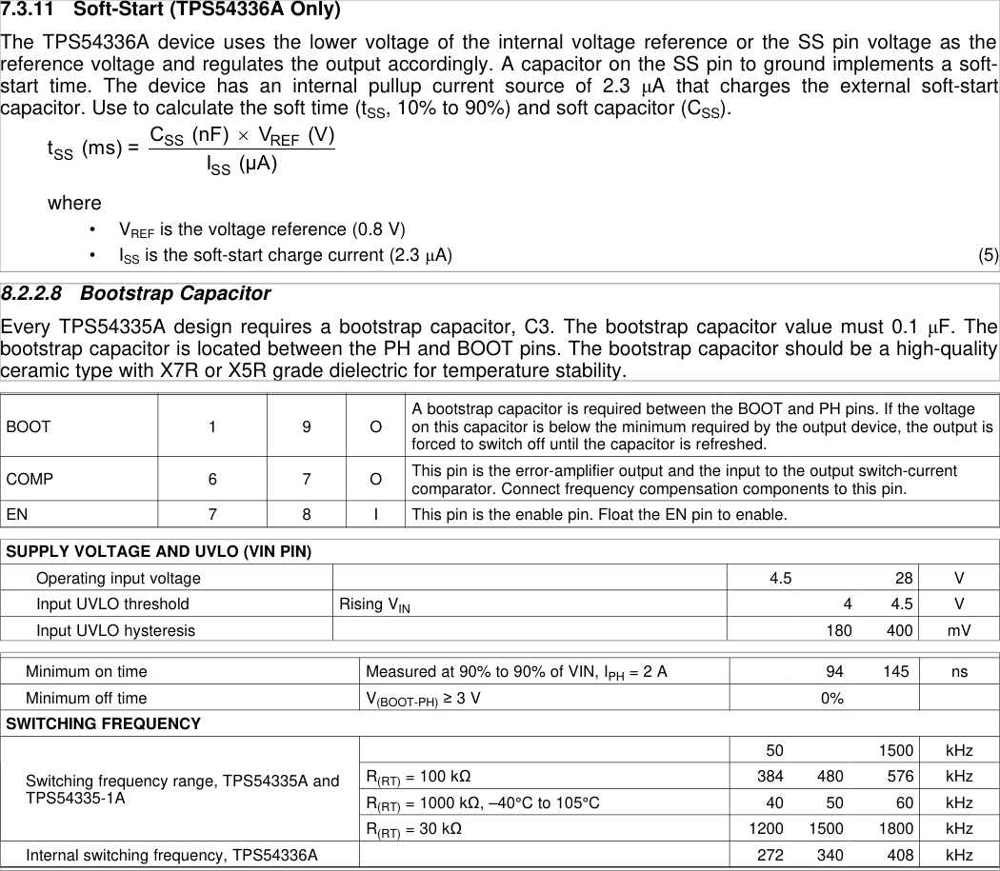 |

| Parameter | DS ref | Our value | Result | DS limit / recommendation | OK? |
|---|---|---|---|---|---|
| FB divider | eq 16; 8.2.2.3 | R16 **73.2 k** / R17 **13.7 k** 1 % | **5.074 V**; worst **4.915–5.238 V** (ref ±1.5 %, R 1 %); ≥ 4.815 V at the port with a 0.1 V drop budget | USB 4.75–5.25 V | OK (was 5.252 V) |
| L | eq 19, 8.2.2.6.1 | **15 µH** (SRP1038A-150M, I_sat 10 A) | L_min 11.3 µH at 16 V; ripple 0.68 A → **K_IND 0.23**; I_pk 3.42 A | K_IND ≤ 0.3; I_sat > 6.5 A limit max | OK (was 0.34) |
| Cout, transient | eq 22 | **4 × 47 µF** X7R 1210 | needs 34.8 µF; effective 47 / 64 / 113 µF at 25 / 34 / 60 % retention: **margin ≥ 35 %** (fsw typ; 8 % at fsw min); loop-based step ≤ 155 mV | 1.5 A step, 5 % (254 mV) | OK (retention assumed; fsw-min eq 22 short of 20 %, see TODO) |
| Cout, ripple / ESR | eq 23 / 24 | ceramic, ESR ≈ 3 mΩ | ≥ 8.3 µF; ESR < 44 mΩ | 30 mV ripple | OK |
| Cin | eq 17 / 18; 10.1 | C15 + **C31** 2 × 10 µF 50 V X7R + C17 100 nF | **227 mV p-p** (10 µF effective; 282 mV at fsw min); I_rms 1.5 A | TI target 400 mV | OK (was 441 mV) |
| Comp R | eq 10 | R18 **7.32 k** | 7.35 k at fc 30 kHz, Co 64 µF | fc ≈ fsw/10 | OK |
| Comp C | eq 11/12 | C20 15 nF | 14.8 nF | eq 12 | OK |
| Comp Cp | eq 13/14 (optional) | none | n/a | optional | OK |
| Loop | 7.3.15 model + `design_calc` | above | fc **15.9–42.4 kHz**, **PM ≥ 45.8°** (Cout 25–60 %, 0.1–3 A, sampling Q 0.3–1, fsw 272–408 kHz; ≥ 51° at fsw typ) | ≥ 45° (usual rule) | OK (model) |
| SS | eq 5 | C19 10 nF | 3.48 ms | TI 10 nF / 3.5 ms | OK |
| BOOT | 8.2.2.8 | C18 100 nF 50 V X7R | — | "must be 0.1 µF" | OK |
| EN / UVLO | pin table; 6.5 | EN floating | UVLO 4.0–4.5 V rising | "Float the EN pin to enable" | OK (back-feed TODO) |
| VIN | 6.5 | 9–16 V; 26 V at the clamp | — | 4.5–28 V | OK |
| fsw, min on-time | 6.7 | fixed | t_on min 478 ns at 26 V | ≤ 145 ns max | OK |
| Thermal | 8.2.2.9 | 3 A, TA 85 °C | 1.0 W typ → TJ ≈ 128 °C (JEDEC) | TJ 150 °C | ~ hot; hiccups at max R_DS (unchanged) |

### Layout

| Datasheet 10.1 / Fig. 55 (p39) | Ours: F.Cu + silk (left), B.Cu (right), same window, viewed from top |
|---|---|
| 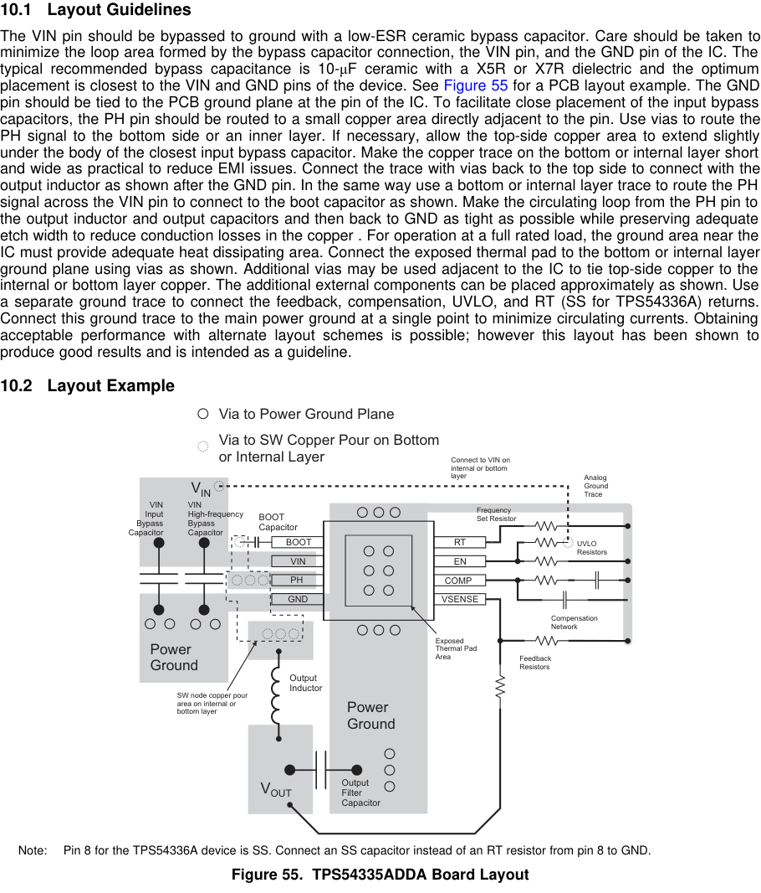 | 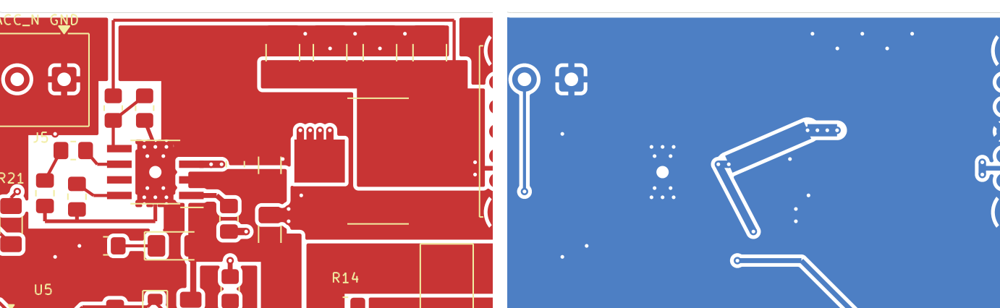 |

- **Power block** (U8, C17, C15) moved as one piece from the top edge to below J5, hot loop unchanged: C17 closest to VIN / GND, C15 behind it, C31 below C15; PH by vias at pin 3 to a 1.5 mm B.Cu trace (≈ 7 mm, was ≈ 12 mm) and back up at L1 pin 1.
- **VSENSE:** R16 / R17 sit directly above pin 5; the `U8_FB` node is 5.5 mm (was 18.6 mm). The long run is the low-impedance `+5V1` sense line from C24 along the top edge.
- **COMP / SS:** R18 / C20 at pin 6, C19 at pin 8, all on F.Cu, on the side away from PH (COMP was on B.Cu, 1.37 mm from PH).
- **Analog ground:** R17, C19 and C20 return by two separate F.Cu traces: R17 to the top end of the PowerPAD, C19 + C20 (joined) to its bottom end. They touch the pour only on pad 9 (U8's ground reference), so no loop; strictly two landing points on the one pad, not the single junction of 10.1 (accepted: µV-level drop across the pad); keep-out `AGND_KEEPOUT` stops the F.Cu GND pour around them.
- GND pour on both layers, PowerPAD centre via and thermal vias, as before.

**Verdict U8:** values meet every datasheet criterion with margin (K_IND 0.23, Cin 227 mV, Cout margin 35 %, VOUT ≤ 5.238 V, PM ≥ 45.8° over the fsw range); the layout follows 10.1 / fig. 55. Open: DC-bias retention is assumed (no vendor curve). **Bench:** VBUS DC level and ripple, a load step, the PH ringing, U8 temperature at 3 A.

---

## U5 CD4541B timer

### Circuit

| Datasheet: frequency-select table, truth table, Fig. 2 oscillator, f equation (p1–2) | Ours (schematic) |
|---|---|
| 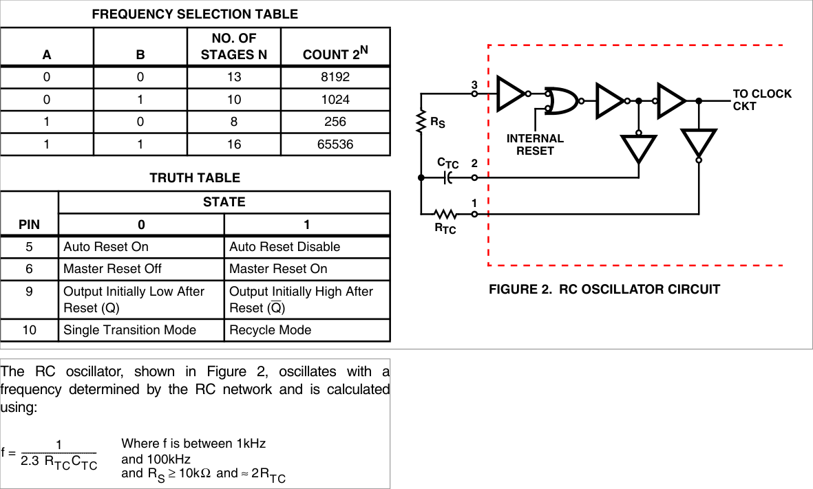 | 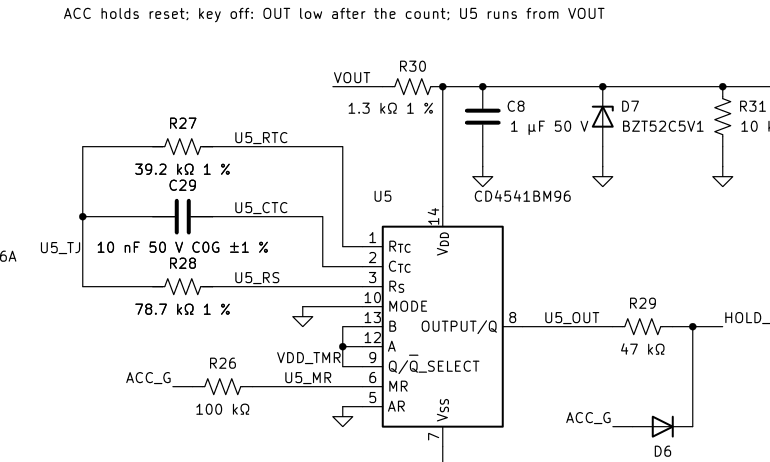 |

### Tuning

| Datasheet: count rule (2^(N−1)), MODE, auto reset, VDD > 5 V note, operating VDD (p1, p3) |
|---|
| 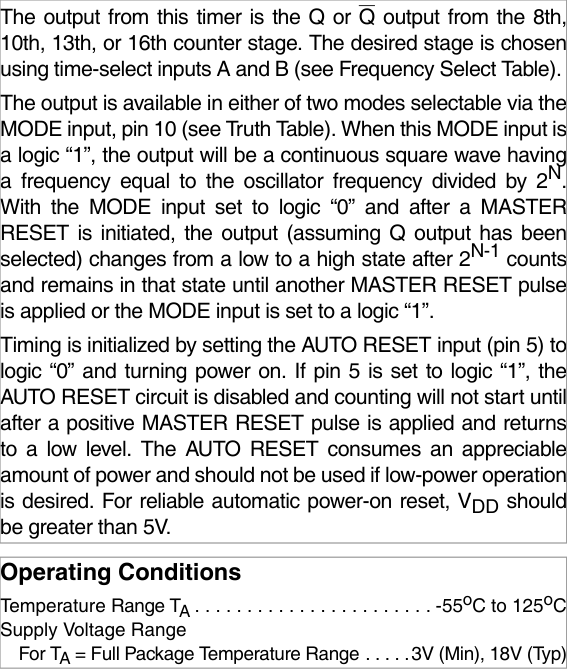 |

| Parameter | DS ref | Our value | Result | DS limit / recommendation | OK? |
|---|---|---|---|---|---|
| Oscillator | p1: f = 1 / (2.3 RTC CTC) | R27 39.2 k, C29 10 nF C0G ±1 % | **1109 Hz** nominal; corners 1008–1253 Hz (k bound 2.104–2.450) | valid 1–100 kHz | OK (long corner 0.8 % above 1 kHz) |
| RS | p1 | R28 78.7 k | 2.01 × RTC | ≥ 10 k, ≈ 2 RTC | OK |
| k tolerance | p1 | — | the design bound comes from a fig. 2 analysis plus a 2 % allowance | DS gives 2.3 only: **no limits and no f-vs-VDD curve** | **open: bench** |
| Tap A, B (12, 13) | freq-select table | both VDD_TMR | N = 16 → output changes after 2^15 = 32 768 counts | — | OK |
| MODE (10) | truth table | GND | single transition, latched until MR | 0 = single transition | OK |
| Q/Q̅ SEL (9) | truth table | VDD_TMR | output high after reset, low at the end of the count | 1 = initially high | OK |
| AR (5) | truth table | GND | auto reset on (adds ≤ 200 µA, accounted for) | 0 = on | OK |
| MR (6) | truth table | ACC_G via R26 100 k | held in reset while ACC is on; counts on key-off | 1 = reset | OK |
| Delay | 32 768 / f | — | **nominal 29.5 s, short 26.1 s, long 32.5 s** (sim 26.16–32.61 s) | target ≥ 25 s | OK |
| VDD | p3 | VDD_TMR 4.45–5.71 V (zener clamp), ≤ 6.5 V at the TVS clamps | — | 3–18 V operating, 20 V abs max | OK |
| Auto-reset VDD | p1 | min 4.45 V | below 5 V at the low corner | "reliable auto reset: VDD > 5 V" | ~ accepted: every key-on is an MR reset (SPEC 3) |

### Layout

SCHS085E has **no layout guidance**: only the SOIC land pattern (p12). We checked against the SPEC 5 "Timer layout" rule instead.

| Ours: F.Cu + silk (left), B.Cu (right) |
|---|
| 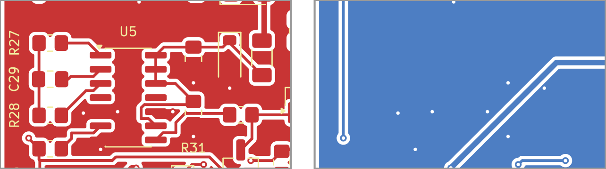 |

- R27, C29 and R28 sit 3.5–5.5 mm from pins 1–3. The `U5_TJ` node is short, with GND pour around it on both layers, and is 22.7 mm from any PH copper. This matches SPEC 5.
- C8 is 3.4 mm from pin 14. It returns to GND through the pour, because pin 7 is on the opposite corner of the package. That is acceptable at 1.1 kHz.

**Verdict U5:** the pin straps match the truth table and the frequency is inside the formula's range. The ≥ 25 s guarantee rests on a k bound that the datasheet doesn't specify. **Bench:** measure f_osc on CTC (pin 2) at VDD_TMR 4.5 / 5.1 / 5.7 V, hot and cold, and the delay itself; check the 10-cycle slow-VDD collapse with no re-latch (SPEC 3).

---

### Doc mismatch

Fixed 2026-11-06: `reports/buck_design.md` rewritten to the current design.
