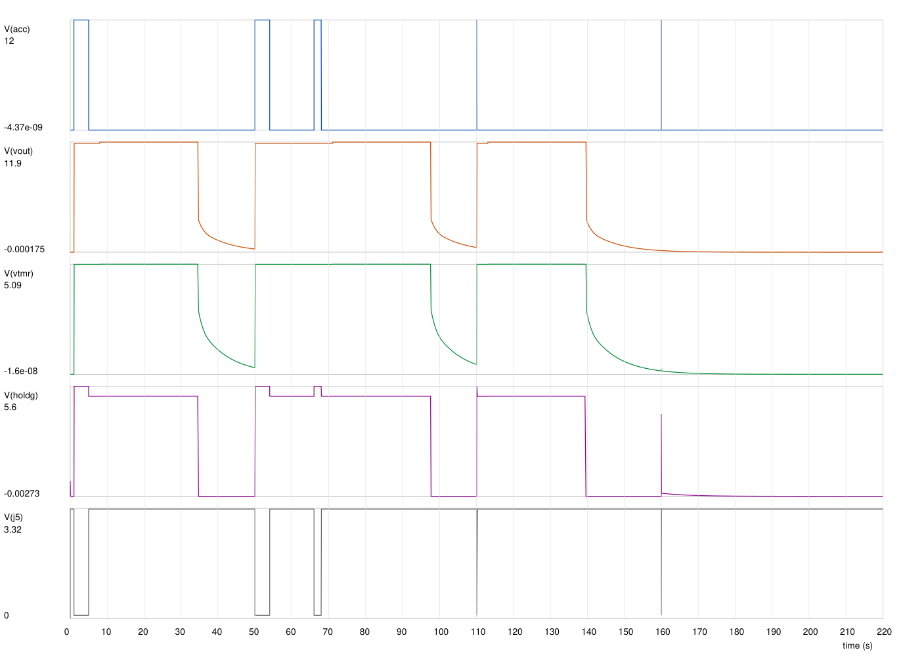

# Sim: delay-off timer, CD4541B clock + counter on VDD_TMR (from VOUT: R30, D7 zener clamp, R31, C8)

Netlists ([SPEC](../docs/SPEC.md) sections 2–4):

- [`ltspice/delay_off_counter.cir`](../ltspice/delay_off_counter.cir): the system at real time, 36 steps (plus the SW1, OVL and overload-sweep runs);
- [`ltspice/cd4541_osc_counter.cir`](../ltspice/cd4541_osc_counter.cir): U5 at gate level.

LTspice 24.1.7, 2026-11-05. Timing parts R27 39.2 kΩ, C29 10 nF C0G ±1 %, R28 78.7 kΩ (staff review A12, for the project lead's ≥ 25 s hold).

**2026-11-05 (latest, A13): U5 from `VOUT` (project lead decision).** `VDD_TMR` = `VOUT` through R30 1.3 kΩ, clamped by D7 BZT52C5V1 (5.1 V zener), R31 10 kΩ bleed, C8 1 µF; replaces `+5V1` → BAT43W → 10 µF. BATT 14.4 V added (36 steps). Q1's off-state leakage (85 °C bound) is on `VOUT` in corner 3. `.save` limits the raw file to the measured nodes. **Result: the USB-overload stuck-on is gone: the hold ends at the count in every overload step.** Previous report and logs (BAT43W + C8): `pi_power_board-backups/*_2026-11-05_115852.*` (including the `_ovlr_typ` and `_ovlr_noD7` logs).

Logs in `ltspice/`:

- `delay_off_counter.log` (36 steps);
- `delay_off_counter_sw1.log` (SW1 run, 12 steps);
- `delay_off_counter_ovl.log` (hard USB overload, 24 steps);
- `delay_off_counter_ovlr.log` (overload sweep 0.5 / 0.8 / 1.0 Ω at 12 V, 9 steps);
- `cd4541_osc_counter.log` (oscillator, 60 steps, VDD 4.45 / 5.1 / 5.71 V);
- `cd4541_counter_x1000.log` (counter logic, 2 steps; unchanged, not VDD-dependent).

The SW1 and sweep runs used the netlist before the `.save` line was added (same circuit).

Hand calc: `pdm run python -I tools/design_calc.py` (`counter_timer()`, `_osc_k()`, `u5_supply()`, `q1_switching()`; `build/design_calc.log`).

```
cd <scratch copy of ltspice/>
timeout 900 "C:\Program Files\ADI\LTspice\LTspice.exe" -b delay_off_counter.cir
sed -e 's/^.param FORCE=0/.param FORCE=1/' -e 's/^.step param LOAD list 1 2 3/.param LOAD=2/' delay_off_counter.cir > delay_off_counter_sw1.cir
sed -e 's/^.param OVL=0/.param OVL=1/' -e 's/^.step param LOAD list 1 2 3/.param LOAD=3\n.step param P_HALT list 0.05 2/' \
    -e 's/^.param T_STOP=220/.param T_STOP=45/' -e 's/^.tran 0 {T_STOP} 0 10m uic/.tran 0 {T_STOP} 0 0.2m uic/' \
    delay_off_counter.cir > delay_off_counter_ovl.cir
sed -e 's/^.step param VB list 9 12 14.4 16/.step param R_OVL list 0.5 0.8 1.0/' -e 's/^.param R_OVL=0.5/* R_OVL stepped/' \
    -e '/^.step param P_HALT list 0.05 2/d' -e 's/^.param P_HALT=2$/.param P_HALT=0.05/' delay_off_counter_ovl.cir > delay_off_counter_ovlr.cir
timeout 900 "C:\Program Files\ADI\LTspice\LTspice.exe" -b delay_off_counter_sw1.cir      (likewise _ovl, _ovlr)
timeout 600 "C:\Program Files\ADI\LTspice\LTspice.exe" -b cd4541_osc_counter.cir
sed -e 's/^.param SCALE=1$/.param SCALE=1000/' -e 's/^.step param VT list.*/.step param VT list 0.3 0.7/' \
    -e 's/^.step param VDD list.*//' -e 's/^.step param CASE list.*//' cd4541_osc_counter.cir > cd4541_counter_x1000.cir
timeout 600 "C:\Program Files\ADI\LTspice\LTspice.exe" -b cd4541_counter_x1000.cir
```

Run times (2026-11-05): main 220 s, OVL 291 s, sweep 280 s, SW1 178 s, oscillator 9 s. Without `.save` an overload run's raw file passes 1 GB.

## How time is scaled

LTspice has no CD4541B model, so the job is split:

```
design_calc _osc_k()    ── fig. 2 solved exactly over the datasheet limits ── k bound 2.104–2.450 ──┐
cd4541_osc_counter.cir  ── run 1, real RTC/CTC/RS: period / (RTC·CTC) = k (cross-check)            │
                        └─ run 2, CTC ÷ 1000: counts to the output edge                            ├─ delay = 32768 · k · RTC · CTC
delay_off_counter.cir   ── U5 as a counter integrating f_osc(k corner) at real time: board scenarios ┘
```

1. **Oscillator, real values** (run 1): datasheet fig. 2. The RS pin feeds an inverter and a NOR (reset). The RTC driver is inverted and the CTC driver in phase; both are fed from the internal node. RTC, CTC and RS meet at one node.
   - Shared threshold VT·VDD, VT 0.3–0.7 (VIL / VIH at 5 V); **VDD 4.45 / 5.1 / 5.71 V** (the `VDD_TMR` range). SCHS085E has no frequency-vs-VDD curve, so the VDD range is covered by solving fig. 2 over it.
   - RS pin: protection diodes, 5 pF, an input-current source.
   - CASE 1 fast: no driver R, hot diodes, 50 ns gate delay. CASE 2 / 3 slow: 370 Ω on each driver, ±1 µA input current, 1 µs gate delay. CASE 4: typical (129 Ω, 200 ns).
2. **Counter logic, ×1000** (run 2): 16 D flip-flops, an output latch, an MR pulse mid-count.
3. **System at real time:** U5 integrates f_osc = 1 / (k · RTC · CTC) per corner.
   - Reset by MR, or by the auto reset: a 1 ms pulse when VDD rises through 2 V, re-armed below 1 V.
   - Counts only at VDD ≥ 3 V; latches low at 32 768 counts; keeps its state while VDD falls.

## Model (system)

| Part | Model | Basis |
|---|---|---|
| U5 CD4541B | As above; MR and OUT with CMOS protection diodes (to `VDD_TMR`); OUT through 370 Ω. Supply current 0.16 / 0.3 / 0.54 mA (corner 1 / 2 / 3: typical / mid / datasheet maxima at 5.7 V), drawn only above 1.5 V (so it is no bleed of its own when nearly unpowered) | SCHS085E; clamp diodes **assumption** |
| R30, D7, R31, C8 | R30 1.3 kΩ `VOUT` → `VDD_TMR`; D7 zener with V_Z at 5 mA = 5.57 / 5.1 / 4.70 V per corner (the calc's upper bound, typ, lower bound), N_BV 10 (≈ 260 Ω at 1 mA, 52 Ω at 5 mA: inside the datasheet's 480 / 60 Ω limits); R31 10 kΩ; C8 0.7 µF effective | Vishay 86342; C8 retention **assumption** |
| Q5, Q6 2N7002BK | VDMOS N, V_TO 2.35 / 1.6 / 0.75 V per corner; Q5 leakage 3 µA in corner 3 | Nexperia |
| Q1, gate | VDMOS P, R14 / R15, C30 100 nF G-S; **off-state leakage 10.5 µA into `VOUT` in corner 3** (I_DSS limits 1 µA / 25 °C and 50 µA / 125 °C, log-interpolated to 85 °C) | SPEC 4, Vishay SQD50P04 |
| U8 + `+5V1` | UVLO 4.5 / 4.32 V, soft start 3.5 ms, source only, 48 µF, FB 63.6 kΩ, USB 2 A (LOAD 1, 2) or none (LOAD 3); current limit 4.7 A; hiccup in the OVL runs: off 16 384 / 408 kHz = 40 ms, on for T_SS + 512 / 408 kHz | SLVSCD5D 6.5, 6.6, 7.3.13 |
| Battery, load | hot-plug at 10 ms, harness 50 mΩ + 1 µH, TVS 18.8 V; constant-power `VOUT` load, 674 µF | as before |

Corners:

- **1 = short:** k 2.104, CTC −1.3 %, RTC −2 %, diodes at max drop, N-FET V_TO 2.35 V, Q1 V_TO −2.5 V, V_Z high, U5 typical current (highest `VDD_TMR`: the MR margin).
- **2 = nominal:** k 2.3.
- **3 = long:** k 2.450, CTC +1.3 %, RTC +2 %, low diode drop, N-FET 0.75 V + Q5 leakage, Q1 −1.1 V + Q1 leakage, V_Z low, U5 maxima (lowest `VDD_TMR`).

Loads: **1** 42 W, the Pi shuts down 3 s after key-off, 17 W USB stays; **2** 42 W throughout; **3** Pi halted (2 W), no USB. Steps: BATT 9 / 12 / 14.4 / 16 V.

Stimulus: battery hot-plug at 10 ms; key on 1–5 s; on 50–54 s; on 66–68 s (12 s into the count); 50 ms blip at 110 s; 2 ms blip at 160 s; stop at 220 s.

## Results

### Oscillator and counter (U5, gate level)

| k = period / (RTC·CTC), VDD 4.45–5.71 V | LTspice run 1 | `_osc_k()` calc |
|---|---|---|
| fast (CASE 1) | 2.111–2.266 | 2.147–2.356 (with ±1 µA) |
| slow (CASE 2 / 3) | 2.158–2.355 | 2.188–2.402 |
| typical (CASE 4) | 2.135–2.286 | – |

- Within 0.002 of the 4.5–5.5 V runs: the wider `VDD_TMR` range does not move k. Bound used: 2.104–2.450 (±2 % model allowance; was 2.105–2.449).
- The LTspice model reads up to 2 % lower than the exact solution (behavioural gate switching instant; an RC segment alone matches to 0.02 %). The allowance covers it. The datasheet's 2.3 is inside both.
- RS-pin clamp current ≤ 65 µA (abs max 10 mA).
- **Counter (run 2, unchanged):** no clock while MR is high; the MR pulse cleared the counter; OUT fell 32 767–32 768 periods after the last MR release; one transition only.

### System

Delay = ACC (or SW1) falling edge to `VOUT` falling through VB / 2.

| Corner | Key-off delay (s) | Restart delay | 50 ms blip | SW1 (s) | f (Hz) |
|---|---|---|---|---|---|
| 1 short | **26.16–26.20** | same | same | 26.16–26.17 | 1253 |
| 2 nominal | 29.56–29.61 | same | same | 29.56–29.58 | 1109 |
| 3 long | 32.56–32.61 | same | same | 32.56–32.58 | 1008 |

The calc gives 26.1 / 29.5 / 32.5 s.

- **≥ 25 s worst case: met, 26.16 s** (margin 1.2 s). BATT and load move it by < 0.05 s.
- **`VDD_TMR` while counting: 4.51–5.70 V** (calc 4.45–5.71 V): corner 1 5.33–5.70 V, corner 2 4.89–5.24 V, corner 3 4.51–4.84 V (9 → 16 V); ≤ 5.70 V with ACC on.
- **Restart mid-count:** `VOUT` never dips (min 8.67 / 11.8 / 15.8 V); the counter is at 0 within 0.5 s of the key-on; the next delay equals the first.
- **Key-on:** `VOUT` reaches 90 % 1.9–12 ms after ACC; `+5V1` 4.5 V after 4.3–13.2 ms; 0.5 ms after the edge `ACC_G` = 1.66–3.12 V and `HOLD_G` = 0.93–2.61 V; U5 OUT = 4.51–5.71 V while ACC is on.
- **Counting:** `HOLD_G` ≥ 4.51 V. Q1 V_GS ≥ 4.81 V (on, 9 V).
- **J5:** 0.096 V while ACC is on, 3.30 V off; released ≤ 0.42 ms after key-off (SW1: ≤ 0.14 ms).
- **No chatter, no re-latch:**
  - never a fifth `VOUT` rise (36 steps; SW1 12 steps);
  - `VOUT` ≤ 1.5 V and `VDD_TMR` ≤ 0.93 V in the off windows (5 s before the next ACC edge), still decaying through R30 / R31 / D3;
  - `HOLD_G` ≤ 1 nV parked and during the collapse; U5 OUT stays low throughout. **Assumption:** the auto reset fires on a rising VDD only;
  - `+5V1` takes up to 4.6 s from 4.5 V to 1 V after a turn-off (LOAD 3); it no longer feeds U5.
- **2 ms blip:** nothing in corners 1–2; a full hold in corner 3 (fast Q1). Acceptable (SPEC 3).
- **Battery hot-plug, key off:** `VOUT` ≤ 0.5 mV in corners 1–2, ≤ 15 mV in corner 3 (Q1 leakage into 674 µF over the first second); `VDD_TMR` ≤ 13 mV; `+5V1` 0; `HOLD_G` kicks to ≤ 1.03 V for microseconds.
- **Q1:** parked V_GS ≤ 0.66 V; inrush 10–20 A, 33–127 W peak; `VOUT` 10–90 % in 1.0–3.3 ms; **turn-off (42 W still on): linear region ≤ 15 ms, ≤ 106 mJ, 20.5 W peak** (calc bound ≤ 19 ms; inside the derated SOA, SPEC 4).
- **MR clamp current** ≤ 57 µA while ACC is on.

### USB overload during the key-off count: closed

Setup (OVL run): 0.5 Ω on `+5V1` from 8 s into the count; U8 hiccups; LOAD 3; the Pi halted (2 W) or in deep power-off (0.05 W); 9 / 12 / 14.4 / 16 V; three corners.

| Run | Steps | Hold ends at the count | Delay (s) | `VDD_TMR` after the overload |
|---|---|---|---|---|
| OVL, 0.5 Ω (hard) | 24 | **24 of 24** (one `VOUT` fall per step) | 26.17–33.04 | 4.53–5.70 V (no dip) |
| Sweep 0.5 / 0.8 / 1.0 Ω at 12 V, 0.05 W | 9 | **9 of 9** | 26.57 / 29.96 / 32.96 per corner, the same at every R | 4.70–5.55 V (no dip) |
| Before: BAT43W + C8 (A12, OVL) | 18 | 1 of 18 | – | 1.0–1.6 V |

- The count is untouched: the counter value 1 s after the overload equals the no-overload run, and the overload resistance makes no difference.
- With the Pi in deep power-off (0.05 W), `VOUT` falls through VB / 2 up to 0.45 s later than with 2 W: almost nothing discharges `VOUT` after Q1 turns off. U5 OUT went low at the count in every step.
- `VOUT` 35–40 s after key-off ≤ 2.4 V and falling (Q1 off).



`reports/sim_delay_off_counter_12V_nominal.png`: ACC, `VOUT`, `VDD_TMR` (vtmr), `HOLD_G`, J5 at 12 V, nominal, LOAD 1 (`pdm run python -I tools/plot_raw.py <raw> <png> 6 "V(acc)" "V(vout)" "V(vtmr)" "V(holdg)" "V(j5)"`).

## Limits of the sim

- **U5 is not a vendor model:** the oscillator is fig. 2 with idealised gates; the system run uses an integrating counter; the auto reset fires on a rising VDD only. Its behaviour on a falling or dipping VDD is not in the datasheet: bench.
- **The k bound rests on the datasheet structure and limits**, not on a tolerance TI states (none is given): bench calibration (TODO).
- **The zener** is a diode model inside the datasheet limits at 1 and 5 mA; between and below them the calc's power-law bound is used **(assumption)**.
- **U8 is behavioural:** no loop; the current limit and the hiccup are a fixed pattern (OVL runs only).
- **Not simulated:** cranking with ACC on; the 2N7002BK gate ESD diodes (IGSS bound in the calc); a back-fed `VOUT` (calc: `VDD_TMR` 3.2–3.7 V at 4.3 V, one hold at most); reverse battery; the parked case without R31 (the U5 model below 3 V is not meaningful there: calc and SPEC 2).
