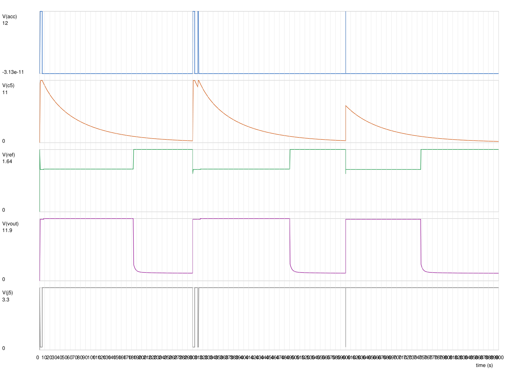

# Sim: delay-off timer, LM2903B redesign

Netlist [`ltspice/delay_off_lm393.cir`](../ltspice/delay_off_lm393.cir) (SPEC 2–4). Logs: `ltspice/delay_off_lm393.log` (18 steps), `ltspice/delay_off_lm393_sw1.log` (SW1 run). LTspice 24.1.7; re-run 2026-11-05 for the 45 s timer (C5 + C27 + C28 = 3 × 10 µF, R9 4.7 MΩ; SPEC 3), sim time 580 s. Hand calc: `pdm run python -I tools/design_calc.py` (`build/design_calc.log`). The old TLC555 sim (`delay_off_timer.cir`, `reports/sim_delay_off.md`) is kept unchanged.

```
cd <scratch copy of ltspice/>
timeout 600 "C:\Program Files\ADI\LTspice\LTspice.exe" -b delay_off_lm393.cir
sed -e 's/^.param FORCE=0/.param FORCE=1/' -e 's/^.step param LOAD list 1 2/.param LOAD=2/' delay_off_lm393.cir > delay_off_lm393_sw1.cir
timeout 600 "C:\Program Files\ADI\LTspice\LTspice.exe" -b delay_off_lm393_sw1.cir
```

## Model

| Part | Model | Basis |
|---|---|---|
| U1 LM2903B | Behavioural, no LTspice model: open-collector switch (100 Ω) to a VOL source; output on while IN− > IN+ + offset and VCC > 2 V; 1 µs response; input bias as currents out of the pins; quiescent current from `BATT` | SLCS005AH 5.6: V_IO ±4 mV, I_B ≤ 50 nA (typ 3.5 nA), VOL ≤ 550 mV at 4 mA, I_Q 450 µA typ / 800 µA max |
| C5 (C5 ∥ C27 ∥ C28) | One charge-defined nonlinear capacitor, C(V) = 30 µF·(1 − 0.04·V); corner 1 adds the insulation from the part's Ω·F figure (1000 Ω·F / 30 µF = 33 MΩ) | DC-bias **assumption** (SPEC 3); Cal-Chip GMC datasheet |
| D5, D6 | One diode model, Is per corner (N 1.68, Rs 0.88: the old BAS116 fit to its V_F maxima) | corner 1: 0.67 V at 5 µA (V_F maximum fit); corner 2 ≈ 0.45 V; corner 3 ≈ 0.40 V |
| Q1 | VDMOS P-channel (the old sim's SQD50P04-13L stand-in: Cgs 2.5 nF, Cgd 0.35–2.2 nF), V_TO per corner | datasheet typicals; threshold −2.5 V cold max / −2.0 V / −1.1 V hot min (assumption −4 mV/K) |
| Battery | Source with a 1 µs hot-plug step at 10 ms, harness 50 mΩ + 1 µH **(assumption)**, TVS1/TVS2 as 18.8 V zeners | |
| Load | Constant power on `VOUT`, cut off below 4.5 V; `VOUT` 674 µF + 20 mΩ (Pi regulator bulk, **assumption** as before); LED D3 + R3 | LOAD 1: 42 W, the Pi shuts down 3 s after key-off (17 W USB remains: `BATT` rises); LOAD 2: 42 W through the whole delay |

Corners: 1 = short (C5 ×0.6885 = tolerance −10 % × temperature −15 % × aging −10 % (2 %/decade, GMC datasheet), R9 −1 %, `REF` divider ±1 % adverse, VOL 0.55 V, IN+ bias 2 × 50 nA into `REF`, offset +4 mV, diodes at their maximum drop, D6 leakage 80 nA, C5 insulation 33 MΩ, Q1 V_TO −2.5 V); 2 = nominal; 3 = long (C5 ×1.265, R9 +1 %, divider the other way, IN− bias 50 nA into C5, low diode drop, Q1 V_TO −1.1 V). Stimulus: hot-plug at 10 ms; key on 1–5 s; on 190–194 s; on again 200–202 s (6 s into the delay); **40 ms blip at 390 s from an empty C5** (the calc's minimum key-on for 45 s is 34 ms).

## Results (sim)

Delay = ACC falling edge to `VOUT` falling through VB/2.

| VB | Corner | Load | Key-off delay (s) | Restart delay (s) | 40 ms blip delay (s) | C5 at key-off (V) | REF on / off (V) |
|---|---|---|---|---|---|---|---|
| 9 | 1 short | 1 / 2 | 59.13 / 60.21 | same | 51.50 | 7.55 | 2.91 / 3.95 |
| 12 | 1 short | 1 / 2 | 57.76 / 58.34 | same | 53.00 | 10.5 | 3.89 / 5.25 |
| 14.4 | 1 short | 1 / 2 | **55.09** / 55.48 | same | 52.14 | 12.9 | 4.66 / 6.29 |
| 9 | 2 nominal | 1 / 2 | 118.64 / 120.76 | same | 98.09 | 7.98 | 2.76 / 3.87 |
| 12 | 2 nominal | 1 / 2 | **110.61** / 111.71 | same | 96.02 | 11.0 | 3.72 / 5.15 |
| 14.4 | 2 nominal | 1 / 2 | 103.21 / 103.94 | same | 92.88 | 13.3 | 4.49 / 6.18 |
| 9 | 3 long | 1 / 2 | 163.73 / **166.68** | same | 131.00 | 8.08 | 2.72 / 3.83 |
| 12 | 3 long | 1 / 2 | 150.13 / 151.63 | same | 125.27 | 11.1 | 3.67 / 5.11 |
| 14.4 | 3 long | 1 / 2 | 139.01 / 140.00 | same | 120.18 | 13.4 | 4.42 / 6.13 |

- **Worst-case short delay 55.1 s (sim), 52.4 s (calc, adds cold diodes and +0.5 V of `BATT` rise): ≥ 45 s** (project lead target, 2026-11-05). Nominal 103–121 s; long up to 167 s.
- **Restart:** key on 6 s into the second delay: `VOUT` never dips (min 8.66 / 11.8 / 14.2 V at 9 / 12 / 14.4 V), and the next delay equals the first to ≤ 0.05 s in every step.
- **Blip from an empty C5 (40 ms):** ≥ 51.5 s in the short corner: a short key-on still gives ≥ 45 s. It is shorter than the key-off delay because 40 ms (≈ 1.7 τ) doesn't fully charge C5; the calc puts the 45 s limit at a 34 ms key-on (SPEC 3).
- **No chatter, no re-latch:** in all 18 steps there is no fourth `VOUT` rise, `VOUT` fall or `DRV` rise after the first key-on (`.meas` FAIL = none found), including LOAD 1 with `BATT` rising 0.15 V mid-delay and at the turn-off.
- **Off between events:** `VOUT` ≤ 1.7 V in every off window (the model's load cuts off below 4.5 V; the LED holds the rest at its knee: a real Pi regulator drains it). Parked V_GS ≤ 0.36 V.
- **SW1 run** (SW1 closed 1–40 s, ACC off, D4 in series with SW1): `VOUT` on throughout, J5 low (0.15 V; 0.64 V in corner 1 with VOL at its 4 mA limit), J5 released 1.1–1.3 µs after SW1 opens; delay after SW1 opens **55.0–58.3 s (short), 103–118 s (nominal), 139–163 s (long)**. (In the SW1 run the key-off windows at 185–190 s still see `VOUT` on in the long corner: SW1 opened at 40 s, so its delay runs past them; expected.)
- **J5:** low 0.15 V while ACC is on (0.64 V in corner 1), 3.30 V when off, released ≤ 0.15 ms after the key-off edge.
- **Q1 gate:** V_GS ≥ 4.51 V on at 9 V in corner 1 (board `BATT` 8.75 V under load, VOL 0.55 V), 4.79 V nominal; 6.2–6.5 V at 12 V. Q1 drop at full load 29–91 mV.
- **Key-on inrush (no slew capacitor):** peak 12–41 A into the 674 µF, Q1 peak power 66–267 W, 26–63 mJ, `VOUT` 10–90 % in 0.30–0.84 ms (not measured in corner 3: the hot-plug pulse leaves `VOUT` above 10 % before the key-on); `BATT` dips to 7.9 / 10.3 / 12.3 V for that time. Inside the derated SOA (SPEC 4).
- **Turn-off:** peak Q1 power ≤ 10 W (9 V, full load still on); 0.1–0.5 W with the Pi already shut down.
- **Battery hot-plug** (all capacitors empty, 1 µs step): V_GS couples to 1.7–2.9 V through C_gd for well under a millisecond. `VOUT` pulse ≤ 0.08 V at 12 V nominal, 0.54 V at 14.4 V nominal, **up to 1.1 / 2.7 / 4.2 V in corner 3** (Q1 threshold at its hot minimum), ≤ 32 mJ in Q1, then decaying (no load below 4.5 V in the model). C5 is not charged and U1A stays off: nothing latches. Accepted in DECISIONS; bench TODO.
- Recharge current through SW1 / R24 is not measured in the sim (the existing `i_sw1_pk` probe reads ≈ 0 in both runs: not investigated, TODO): the calc bound is 15.9 mA at 16 V (SPEC 3).



`reports/sim_delay_off_lm393_12V_nominal.png`: ACC, `C5_T`, `REF`, `VOUT`, J5 at 12 V, nominal, LOAD 1 (`pdm run python -I tools/plot_raw.py <raw> <png> 5 ...`).

## Limits of the sim

- U1 is behavioural: a 0.5 mV switch hysteresis inside the model (negligible against R23's 1.4 V); no input common-mode behaviour (the datasheet guarantees the output with one input above the range, SPEC 3), no output saturation curve beyond the VOL source.
- C5's DC-bias curve is an assumption; the BOM phase must check the real part (SPEC 3, TODO). The delay scales about linearly with the effective capacitance.
- C5's insulation is a fixed 33 MΩ in corner 1 (the GMC 1000 Ω·F figure); the calc gives the requirement (≥ 13.9 MΩ for the node, 417 Ω·F per part). Below about 100 Ω·F (the common X7R minimum) the 45 s target is out of reach (SPEC 3).
- Cold diode drops (+0.13 V), and the `BATT` rise beyond the modelled 50 mΩ harness, are in the hand calc only.
- The Q1 model has no sub-threshold conduction and its C_gd(V) is a two-value VDMOS fit: the hot-plug pulse size is indicative only.
